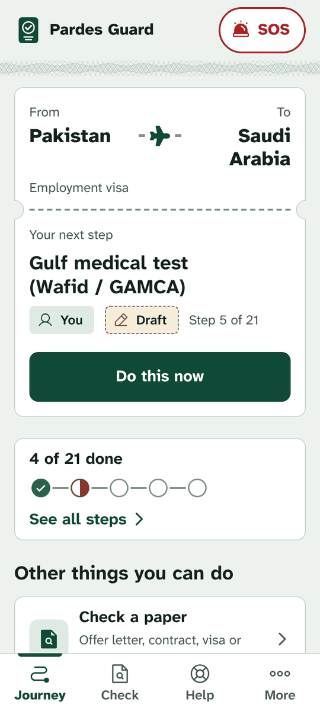
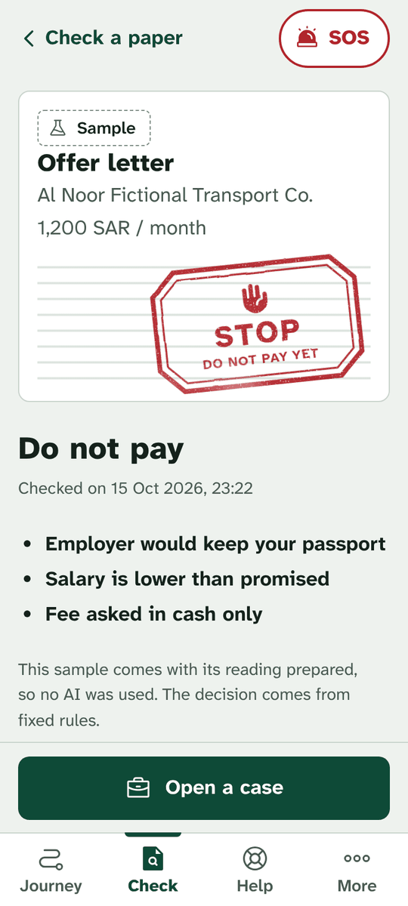
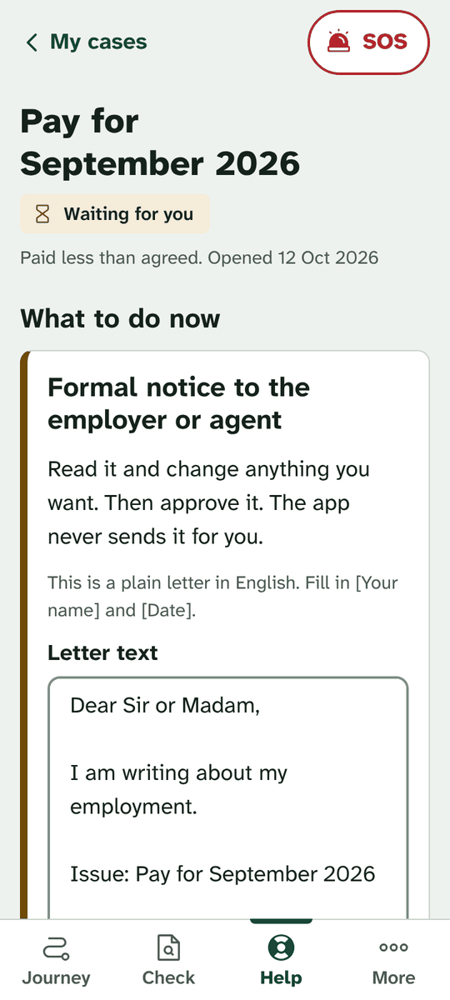
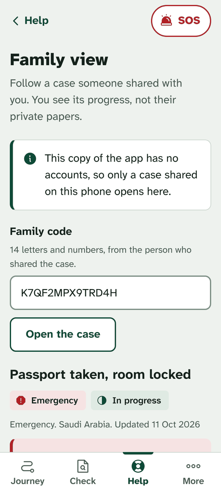
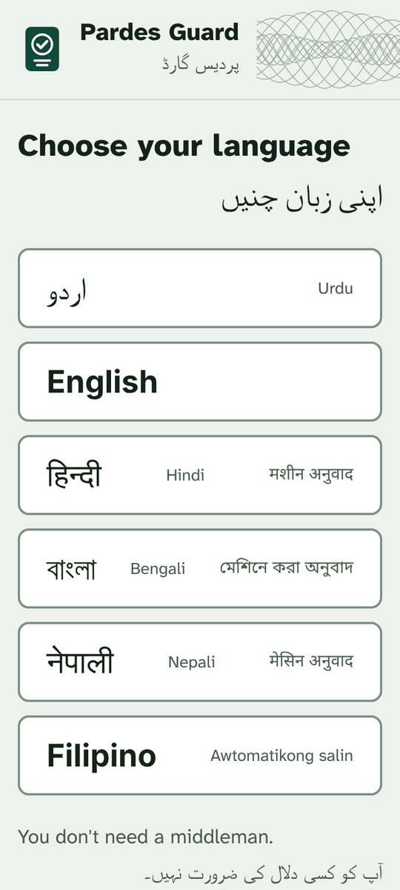
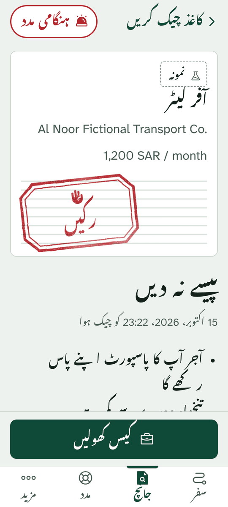
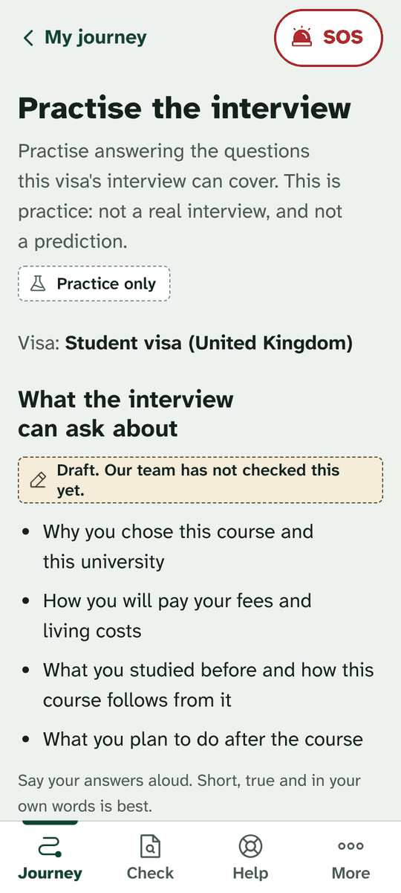
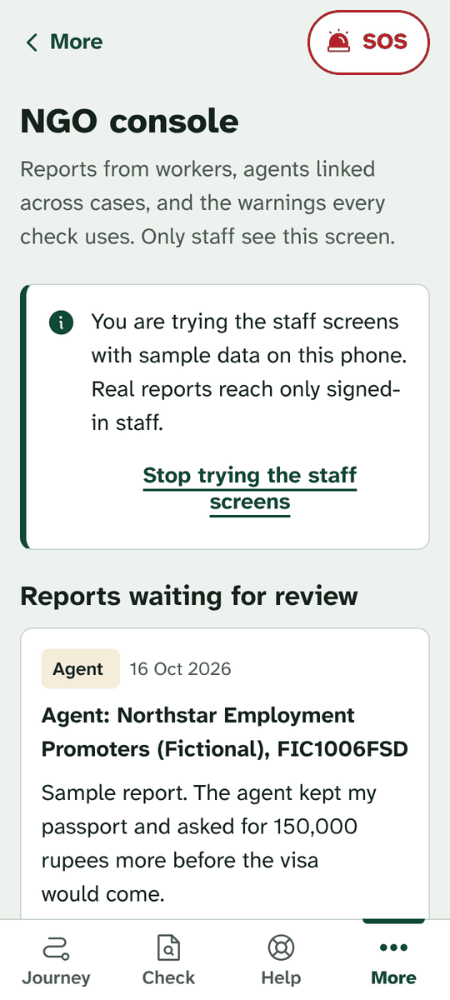
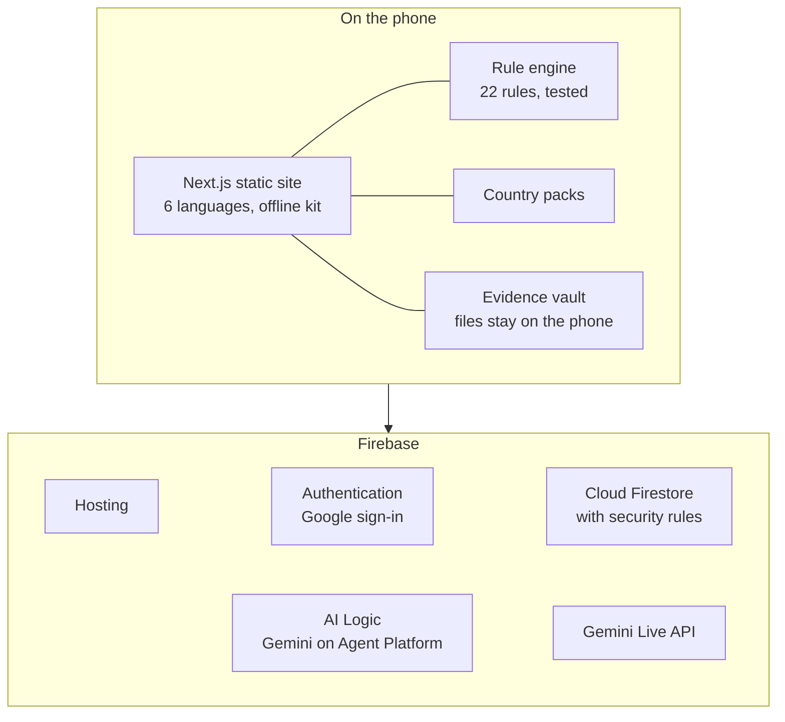
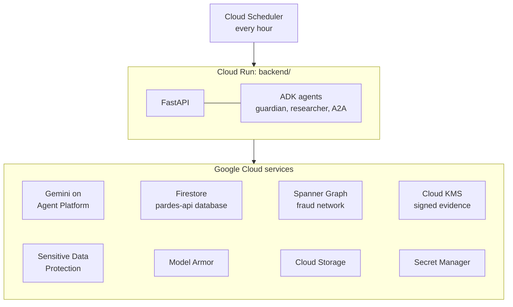

<p align="center"></p>

<h1 align="center">Pardes Guard</h1>

<p align="center"><strong>You don't need a middleman.</strong></p>

Pardes Guard is a free phone web app for people going abroad for the first time for work or study, and
for their families. It shows every step of the journey, what each step should really cost, and checks
an agent and their papers for warning signs before anyone pays. If something goes wrong abroad, it
helps the person write letters they send themselves and keeps their evidence safe.

| Live app | API sandbox | Demo video (under 3 minutes) | Deck (PDF) |
|---|---|---|---|
| [pardes-ea3e1.web.app](https://pardes-ea3e1.web.app) | [API docs on Cloud Run](https://pardes-guard-api-4ycjladhqa-el.a.run.app/api/docs) | To be added | To be added |

Built for the Google Cloud AI Builder Cup 2026, Sustainability & Social Impact track.

<table>
  <tr>
    <td align="center" width="25%"><br><sub>The next step, as a boarding pass</sub></td>
    <td align="center" width="25%"><br><sub>A checked offer: STOP, with reasons</sub></td>
    <td align="center" width="25%"><br><sub>A letter the person approves and sends</sub></td>
    <td align="center" width="25%"><br><sub>Family follow a case with a code</sub></td>
  </tr>
  <tr>
    <td align="center"><br><sub>Six languages</sub></td>
    <td align="center"><br><sub>The same check, in Urdu</sub></td>
    <td align="center"><br><sub>Interview practice (UK student visa)</sub></td>
    <td align="center"><br><sub>NGO console</sub></td>
  </tr>
</table>

<sub>Every name, company, paper and phone number in these pictures is made up.</sub>

## The problem

Going abroad for the first time means documents, a visa, medical tests and tickets, and the process is
confusing. So people pay local agents and brokers to handle it. Many agents overcharge, use borrowed
or fake licences, hand over fake visas or contracts, or keep passports. Once abroad, workers who are
paid short or late often do not know whom to contact.

The people this hurts most are first-time travellers, many of whom read Urdu or another language
rather than English, use a cheap Android phone on a weak connection, and have never dealt with a visa.
Pardes Guard is built for them: plain words, voice in and out, a simple mode, and key screens that
keep working without internet.

## Two people it is built around

**Ahmed, Pakistan to Saudi Arabia, work.** An agent offers him a driver job and asks for a large fee
in cash. He photographs the offer letter. Pardes Guard reads it and finds that the salary on paper is
lower than he was promised, the employer would keep his passport, and the fee is cash only: a red
STOP stamp, with the reason and source for each finding. It shows him the official route, what each
step should cost, how to look up a licensed agent, and his journey to departure. Later, abroad, his
pay comes short. He opens a case, the app drafts a letter that he edits, approves and sends from his
own WhatsApp, and his family follows the case with a share code.

**Ayesha, Pakistan to the United Kingdom, study.** She has an admission letter. The app checks it for
scam signs, builds her journey (CAS, English test, proof of funds, TB test, visa application), scans
her papers for problems such as a passport that expires too soon or a name spelled two ways, and lets
her practise the visa interview by voice.

## What it does

**Before going**

| Screen | What it does |
|---|---|
| Journey | Three questions (why, from, to) build a personal plan from the country packs: documents, visa steps, departure and arrival. Each step says who does it, where to go, its official link and whether the team has checked it. Stages are passport pages that get stamped. |
| Check | Photos, PDFs or a voice note of an offer letter, contract, visa or admission letter. Gemini reads them; fixed rules decide. Red STOP, amber CHECK or green LOOKS OK, with every reason, its evidence and its source, and next steps. Hidden instructions aimed at AI readers are caught. With the AI off, a typed form gives the same rules-based result. Four fictional samples to try. |
| Agents | Search the licensed list (a fictional sample until an admin imports the official one), see a licence's status and staff warnings, rate an agent, report one. |
| Real cost | Each official cost of the route, with a number only when it has a source and a checked date, compared with what the agent asks. |
| Readiness scan | Reads the name and expiry from each paper (the photos are not kept), checks months left on the passport and the name spelling across papers. |
| Eligibility | What a person writes, compared by code with each route's listed requirements, with the reason for every line. Never "you are eligible". |
| Interview practice | A voice (Gemini Live) or typed practice interview built from the route's own topics, with per-topic feedback labelled practice. |
| Assistant | Questions answered by Gemini through five read-only functions over the app's own data, by typing or by voice. Links under each answer come from the data, never from the model. |
| Important dates | The passport date, each case's next step and the person's own dates, each with a Google Calendar link. |

**If something goes wrong**

| Screen | What it does |
|---|---|
| Cases | Wage, passport or fraud problems as a ladder of letters (employer, embassy, legal aid or regulator). The person edits, approves and sends each letter from their own WhatsApp or email. Nothing is sent by the app. |
| Wage check | Short or late pay against the contract, then a case in one tap. |
| Evidence vault | Files stay on the phone; each gets a SHA-256 fingerprint chained to the one before, and everything downloads as a ZIP with a manifest. |
| Family view | A 14-character code shows a case's progress to family, never its letters or files. |
| SOS | Quick exit to a blank page, help contacts from the packs, a WhatsApp message to send yourself, an emergency case. |

**For NGO staff and admins**

| Screen | What it does |
|---|---|
| NGO console | Staff review worker reports, see agents linked by shared phones or fee accounts, publish warnings that every check then uses, and confirm fake document layouts. Anyone can try it with sample data on their own phone. |
| Admin | An admin imports the official licensed list from a CSV file, after a preview, and every agent check uses it. |
| Privacy | A plain page on what is kept and where, the AI answer language, sharing warnings (opt-in), and "Delete everything". |

Country packs ship for Pakistan and the Philippines (origin) and Saudi Arabia, UAE, Qatar, Japan,
South Korea, Canada, the UK and Australia (destination). **This is a prototype: the app labels all of
this content "Prototype"** and asks the person to confirm each item on the official website linked to it.
Every Pakistani document guide links to its issuer's own site where there is one (passport: DGIP; CNIC
and FRC: NADRA's Pak Identity; HEC, MOFA and IBCC attestation). The police certificate, which each
province issues on its own, has no link yet.

## How Gemini is used

One rule shapes the design: **decisions are code, words are Gemini.** Verdicts, risk scores, fees,
eligibility, wage arithmetic and case timing come from deterministic, tested code (22 rules in
`frontend/lib/engine/rules.ts`). Gemini does the work that needs language:

| Task | What Gemini does | What code does |
|---|---|---|
| Reading papers and voice notes | Turns a photo, PDF or voice note into structured JSON against a fixed schema | Screens the reading for injected instructions, runs the rules, decides the stamp |
| Explaining a result | Explains the verdict in the person's own language | Picks the reasons, sources and next steps that are shown |
| Letters | Drafts each letter of a case | Holds every letter until the person approves it; the person sends it from their own apps |
| Assistant | Answers questions using function calling over five read-only functions (licensed list, visa route, requirements, wage check, help contacts) | Supplies the data and the links; the assistant cannot send or change anything |
| Interview practice | Plays the interviewer by voice (Gemini Live) or text, then writes per-topic feedback | Builds the topics from the route's own data and labels everything as practice |
| Readiness scan | Reads the name and expiry date from each paper | Counts the months left and compares the spelling across papers |

The live app reaches Gemini on Agent Platform through Firebase AI Logic. It calls `gemini-3.8-flash`,
falls back to `gemini-3.5-flash-lite`, and uses `gemini-live-2.5-flash-native-audio` for voice. When Gemini is unavailable or
out of quota, the app says so and keeps working with the rules, the typed form and template letters.
A paper that could not be read never gets a green stamp.

The production API (`backend/`) adds Google's Agent Development Kit: a `guardian` agent with the app's
tools and an `official_researcher` agent with Google Search, and speech through Gemini text-to-speech.
Through Agent2Agent (A2A) it can hand an approved case to a legal-aid partner's agent, and it publishes
a public-information agent, with no access to personal data, that other organisations' agents can
call.

## How it is built

The live app (what the live link serves):



The production API in `backend/`:



The live app runs on Firebase Hosting with Firebase Authentication, Firestore and Gemini on Agent
Platform through Firebase AI Logic. The production API runs on Cloud Run: ADK agents with Gemini on
Gemini Enterprise Agent Platform, Firestore, a Spanner Graph fraud network, Cloud KMS-signed evidence,
Sensitive Data Protection, Model Armor, Secret Manager and Cloud Scheduler.
[`backend/LIVE_CHECK.md`](backend/LIVE_CHECK.md) records the end-to-end check of the deployed API.

The live app does not call the API. The API runs as a sandbox (nobody signs in, every caller is treated
as a worker, staff routes are closed) so it can be tried from its docs page; [`infra/CLOUD_RUN.md`](infra/CLOUD_RUN.md)
deploys it.

### Google Cloud and Firebase services

| Service | Used for | Where |
|---|---|---|
| Firebase Hosting | The static site and its security headers | Live app |
| Firebase Authentication | Google sign-in (guests use the app without an account) | Live app |
| Cloud Firestore | Journeys, checks, cases, evidence records, shares, reports, signals, published warnings, with rules that check ownership and staff roles | Live app |
| Firebase AI Logic with the Agent Platform Gemini API | Reading papers and voice notes (JSON schemas), explanations, translations, letters, the assistant (function calling), interview feedback | Live app |
| Gemini Live API (`gemini-live-2.5-flash-native-audio`) | Talking to the assistant and interview practice, with transcripts | Live app |
| Google Calendar template links | Saving important dates, filled in, by the person | Live app |
| Google Search and Maps links | Looking up an employer named on a paper (plain links) | Live app |
| Google Fonts | Atkinson Hyperlegible Next and the Noto families for Urdu, Arabic, Devanagari, Bengali, Sinhala and Tamil, served from the site | Live app |
| Agent Development Kit, Gemini on Agent Platform | The guardian and researcher agents, reading, letters, speech | Production API |
| Cloud Run, Cloud Build, Artifact Registry | Running and building the API | Production API |
| Spanner Graph | The fraud network: agencies, phones, accounts and cases as a property graph | Production API |
| Cloud KMS | Signing each evidence record so the chain can be verified with the public key | Production API |
| Sensitive Data Protection | Masking personal numbers in what is stored | Production API |
| Model Armor | Screening uploaded text for prompt injection, jailbreaks and malicious links | Production API |
| Cloud Storage, Secret Manager, Cloud Scheduler | Evidence files, the hashing salt and signing key, moving case steps forward | Production API |

## Safety and privacy

- Uploaded papers are untrusted. They go to Gemini wrapped as data, every answer is screened for
  injected instructions, and a hit becomes a visible flag.
- Gemini never decides a verdict, a fee, eligibility or a deadline.
- No official link, office, fee, phone number or rule is filled in from memory. An empty field shows
  "not added yet", and every pack item says whether the team has checked it.
- Phone and account numbers keep only their last four digits in checks, cases and letters. Fraud
  signals are hashed on the phone before they are shared, and only when the person opts in.
- Nothing is sent on the person's behalf. No case escalates on its own: the ladder moves when the app
  opens, and each letter waits for the person's approval and is sent from their own apps.
- The app never asks for a government portal password and never submits a form.
- Staff are named only in `roles/{uid}`, which the client cannot write; `firestore.rules` checks it on
  every staff read and write.
- Files in the vault never leave the phone; only their records do. Photos from the readiness scan are
  not kept.

Every choice, with its reason, is in [`DECISIONS.md`](DECISIONS.md).

## Try it

**On the live link** (no sign-in needed), in about three minutes:

1. Choose English or Urdu. Answer the three questions: I have a job offer, Pakistan, Saudi Arabia.
   Home shows the next step as a boarding pass.
2. Check > Try a sample > "Driver job in Saudi Arabia, with a voice note". The red stamp lands; open
   the reasons and their sources.
3. Open a case from the result. Edit and approve the letter, then open it in WhatsApp. Share it with
   family: Help > Family view opens the code (on another phone too, once you sign in with Google).
4. More > Staff > Try the staff screens (not shown in simple mode), then the NGO console: reports,
   linked agents, and publishing a warning that the next check uses.
5. Journey > Change my answers: I have admission or a scholarship, Pakistan, United Kingdom. See
   Ayesha's journey, the readiness scan and interview practice.

**On your computer.** You need Node 22 (`node -v` should print `v22...`):

```bash
cd frontend
npm ci                 # installs exactly the versions in package-lock.json
npm run dev            # open http://localhost:3000
```

With no Firebase values the app runs fully on the device: no sign-in, data stays in the browser, no
Gemini (each AI screen says so and offers its typed or rules-only path). To see the built site the way
Firebase Hosting serves it, offline kit included: `npm run build`, then `npm run preview` and open
http://localhost:4173.

The API on your computer: `cd backend`, create a virtual environment,
`pip install -r requirements-dev.txt`, copy `.env.example` to `.env`, and run
`uvicorn app.main:app --reload`. With a `GEMINI_API_KEY` from Google AI Studio it uses Gemini;
without one it runs on the rules and says the paper was not read. `python -m app.scripts.smoke_check`
runs one made-up offer through it.

Deploying: [`docs/DEPLOY.md`](docs/DEPLOY.md) for the live app, [`infra/CLOUD_RUN.md`](infra/CLOUD_RUN.md)
for the API.

## Tests

```bash
cd frontend
npm run typecheck
npm test               # unit tests (vitest): engine, store, AI fallbacks, letters, assistant, i18n
npm run build
npx playwright install --with-deps chromium     # once, on a new computer
npm run test:e2e       # Playwright on the built site: both hero stories, every screen,
                       # axe accessibility checks, text at 200%, keyboard only, offline kit
npm run test:rules     # Firestore rules against the emulator (needs Java)

cd ../backend && python -m pytest -q
```

The browser tests expect a build without Firebase values. Rename `frontend/.env.local` before
`npm run build` and `npm run test:e2e`, and put it back before the next deploy build.

Last run on 16 October 2026: 356 unit tests, 294 browser tests and 96 API tests passed; 2 API tests
were skipped because they need a Spanner emulator or instance. The Firestore rules tests have not run
yet (they need Java). [`.github/workflows/tests.yml`](.github/workflows/tests.yml) runs the type check,
unit tests, build and API tests on every push.

## What has been verified, and what has not

Verified on the built site in headless Chromium at phone size: both hero stories end to end, every
screen in English and Urdu (light and dark) with no serious axe finding, the busiest screens in the
four machine-drafted languages, text at 200% with no sideways scrolling, keyboard-only use, the offline
kit with the server stopped, the NGO warning reaching a worker's check, and an imported licensed list
reaching the agent search.

The deployed API on Cloud Run, 17 October 2026 ([`backend/LIVE_CHECK.md`](backend/LIVE_CHECK.md), 13
of 13 passed, made-up papers only): Gemini on Agent Platform read the made-up offer, its hidden
instruction was flagged and the result was red; Firestore kept the check for its owner and answered
404 to anyone else; Spanner Graph linked two made-up agencies through a shared phone; Cloud KMS signed
the evidence, the file went to Cloud Storage and the chain verified; the ADK assistant answered using
one of its tools; and speech came back. Cloud Run's logs for that run show no fallback from Model Armor
or Sensitive Data Protection to the local screens, and Cloud Scheduler's case timer, run once by hand,
got a 200 from the API.

On the live link: a paper check's Gemini call through Firebase AI Logic returned 200 from the Agent
Platform endpoint.

Not run against Google yet: the live app's Gemini Live calls (voice), Google sign-in, Firestore and its
rules from the live app, and a real phone (fonts, voices, microphone, camera).

Content to check before real people use it: every country pack item (all draft), the recruiter list
(a fictional sample until an admin imports the official CSV), Pakistan's legal maximum recruitment fee,
help contacts for Saudi Arabia and the UK, and a native speaker's read of every language. What is left,
and where each item goes: [`docs/CONTENT.md`](docs/CONTENT.md).

Pardes Guard flags warning signs; it cannot prove a paper is genuine and does not give legal advice.

## Repository layout

```
frontend/            the live app: Next.js static export, rule engine (lib/engine),
                     stores, AI providers, country packs (data/), dictionaries
                     (lib/i18n/locales), unit and browser tests
frontend/DESIGN.md   the design system
backend/             the production API: FastAPI, ADK agents, services, tests, and
                     the country packs the web app's copy is made from
infra/               Cloud Run setup and deploy scripts, Cloud Build, Spanner schema
docs/                deploying, content still to check, screenshots
firestore.rules      the live app's Firestore rules
firebase.json        Firebase Hosting settings and headers
DECISIONS.md         what was decided and why, and what has not been tested
```

## Team

| Person | Owns |
|---|---|
| Ahsaan | API, ADK agents, case engine, evidence chain, integrity network, A2A, deployment |
| Rimsha | Gemini prompts and reading quality, red-team run with Gemini, country pack verification |
| Muneeb | Web app, Urdu copy, accessibility, demo video, deck |

## Licence

The code is under the [MIT License](LICENSE). The fonts in `frontend/public/fonts/` are under the SIL
Open Font License (`OFL.txt` there), and the flag images keep the flag-icons licence in
`frontend/public/flags/LICENSE.txt`.
